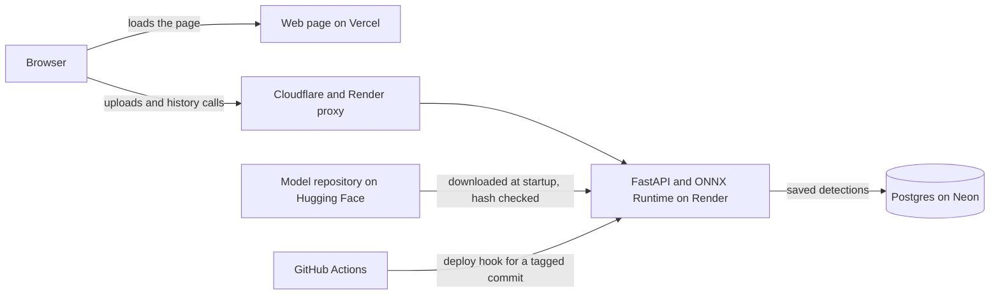

# Architecture

## The pieces

The web page is static files. It calls the API directly from the browser, and the API only accepts calls from the addresses listed in `WEEDLAB_CORS_ORIGINS`.

## What happens on a detection

1. The browser sends the photo to `/v1/detect` with its random visitor id in the `X-Visitor-Id` header.
2. The API checks the visitor id format and the rate limit. The limiter counts per client address, read from `X-Forwarded-For` with `WEEDLAB_TRUSTED_PROXY_HOPS` entries counted from the right.
3. The upload is checked: size, pixel count, and decoding as a real JPEG, PNG or WEBP.
4. The ONNX model runs on the CPU and returns boxes, species and scores. Box coverage is computed from the boxes.
5. The result and a resized thumbnail are saved in Postgres under the visitor id.
6. The response goes back to the browser, which draws the boxes and lets the confidence slider hide or show them.

History, statistics and deletes only ever touch rows that carry the caller's visitor id. A background task deletes rows older than `WEEDLAB_RETENTION_DAYS`.

## Startup

The container command runs three things in order: fetch and verify the model file, apply database migrations, then start the server. A missing or mismatched model stops the service on purpose.

## Releases

Pull requests run lint, type checks, tests and image builds in CI. Merging to `main` does not deploy. Pushing a version tag runs a workflow that checks the tagged commit is on `main` and then asks Render to deploy that exact commit. Steps for deploying and rolling back are in [`runbook.md`](runbook.md).

## Where the code lives

| Area | Location |
|---|---|
| API routes and setup | `src/weedlab/api/app.py` |
| Settings and validation | `src/weedlab/api/settings.py` |
| Database tables and queries | `src/weedlab/api/db.py`, `src/weedlab/api/store.py`, `migrations/` |
| Rate limiting and client address | `src/weedlab/api/ratelimit.py`, `src/weedlab/api/clientip.py` |
| Model download and check | `src/weedlab/api/model_fetch.py` |
| Inference | `src/weedlab/inference.py` |
| Web page | `frontend/` |
| Workflows | `.github/workflows/` |